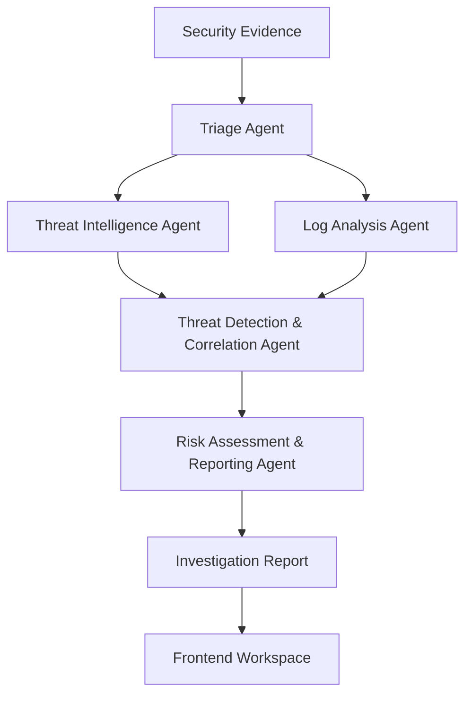

# ThreatForge

### Autonomous Multi-Agent Cybersecurity Investigation System

ThreatForge is an AI-powered cybersecurity investigation platform designed to analyze security evidence, investigate suspicious activity, correlate potential threats, and generate structured incident assessment reports through a coordinated multi-agent workflow.

Built around **LangGraph**, ThreatForge organizes security investigation into specialized stages, allowing multiple agents to examine evidence from different perspectives and contribute to a unified investigation.

---

## Overview

Security teams often deal with large volumes of alerts, logs, suspicious IP addresses, and network activity. Manually investigating every alert can be time-consuming and makes it difficult to identify relationships between seemingly unrelated events.

ThreatForge aims to streamline this process through a structured multi-agent investigation workflow.

The system accepts security evidence, processes it through specialized agents, correlates relevant findings, evaluates potential risk, and produces an investigation report.

### Key Objectives

- Automate structured security evidence analysis.
- Coordinate specialized AI agents through LangGraph.
- Identify suspicious patterns and potential indicators of compromise.
- Correlate findings across different evidence sources.
- Assess incident severity and investigation confidence.
- Generate structured investigation reports.
- Preserve uncertainty when evidence is incomplete or insufficient.

## Architecture

ThreatForge uses a multi-agent architecture orchestrated through LangGraph.

### Agent Workflow

The system consists of five specialized agents:

| Agent | Responsibility |
|---|---|
| Triage Agent | Examines incoming evidence and identifies its type, relevance, and initial priority. |
| Threat Intelligence Agent | Checks available threat intelligence sources for relevant reputation and contextual information. |
| Log Analysis Agent | Examines security logs and extracts relevant events, indicators, and suspicious patterns. |
| Threat Detection & Correlation Agent | Connects findings, identifies relationships, and develops potential threat hypotheses. |
| Risk Assessment & Reporting Agent | Evaluates the investigation results and produces a structured incident report. |

### Investigation Flow



The agents exchange information through shared investigation state managed by LangGraph. Conditional routing determines the appropriate execution path based on the available evidence and investigation results.

## Core Features

### Multi-Agent Investigation
A coordinated workflow divides investigation responsibilities among five specialized agents.

### Security Evidence Analysis
Designed to process security-related evidence such as:

- IP addresses
- URLs
- File hashes
- SSH authentication logs
- Network-flow data
- Incident descriptions

Actual supported input formats depend on the implemented backend parsers.

### Threat Intelligence
Optional integration with external threat intelligence providers can enrich investigations with reputation information.

### Threat Correlation
Combines extracted indicators and observed events to identify relationships and potential attack patterns.

### Risk Assessment
Produces an assessment containing relevant findings, severity, confidence, hypotheses, and recommendations.

### Investigation Workspace
A frontend interface for submitting evidence and viewing investigation progress and results.

### Investigation History
Designed to provide access to previous investigations, subject to the configured persistence implementation.

## Technology Stack

| Technology | Purpose |
|---|---|
| Python | Backend development and evidence processing |
| FastAPI | Backend API and request handling |
| LangGraph | Multi-agent orchestration and workflow management |
| Next.js | Frontend application |
| React | Interactive user interface |
| TypeScript | Frontend type safety |
| Tailwind CSS | Interface styling |
| Vercel | Frontend and backend deployment |

Additional libraries and integrations should be documented according to the actual dependency files.

## Project Structure

```text
ThreatForge/
│
├── frontend/
│   ├── app/ or pages/
│   ├── components/
│   ├── lib/
│   ├── public/
│   ├── .env.example
│   └── package.json
│
├── backend/
│   ├── main.py
│   ├── graph.py
│   ├── csv_loader.py
│   ├── data/
│   ├── tests/
│   ├── .env.example
│   └── requirements.txt
│
├── .gitignore
└── README.md
```

The structure above is illustrative. Retain the actual directory and file names from the repository when finalizing this documentation.

## Dataset

ThreatForge uses the CIC-IDS Collection as a source of network-flow evidence and potential evaluation data.

Dataset source:

[CIC-IDS Collection — Kaggle](https://www.kaggle.com/datasets/dhoogla/cicidscollection)

The dataset includes network traffic features and attack categories such as:

- Benign
- Bruteforce
- DDoS
- DoS
- Botnet
- Portscan
- Infiltration
- Webattack

### Dataset Usage

The intended approach is to use selected network-flow records as investigation evidence.

The `ClassLabel` and `Label` columns contain ground-truth category information. These labels should remain separate from the agent-visible investigation input to prevent the investigation workflow from simply reading the correct answer.

The project does not require a trained ML classifier for this approach. Detection and correlation are handled through the implemented analysis logic and agent workflow.

Dataset availability and actual integration should be verified against the current backend implementation.

## Investigation Output

An investigation report is designed to organize results into sections such as:

- Incident classification
- Severity assessment
- Confidence level
- Extracted indicators
- Observed security events
- Threat hypotheses
- Correlated evidence
- Investigation findings
- Recommendations
- Uncertainty and limitations
- Agent execution status

ThreatForge should distinguish observed facts from hypotheses. A suspicious pattern should not automatically be presented as a confirmed compromise.

## Environment Configuration

ThreatForge uses environment variables to configure frontend connectivity and backend integrations.

### Frontend

Create `frontend/.env.local`:

```env
NEXT_PUBLIC_API_BASE_URL=http://localhost:8000
```

For production, replace the value with the deployed backend URL.

### Backend

Create `backend/.env`:

```env
CORS_ALLOWED_ORIGINS=http://localhost:3000,http://127.0.0.1:3000

CORS_ALLOWED_ORIGIN_REGEX=

VT_API_KEY=
ABUSEIPDB_API_KEY=
```

| Variable | Purpose | Required |
|---|---|---|
| `NEXT_PUBLIC_API_BASE_URL` | Backend API address | Yes |
| `CORS_ALLOWED_ORIGINS` | Permitted frontend origins | Yes for configured cross-origin deployment |
| `CORS_ALLOWED_ORIGIN_REGEX` | Optional preview deployment origins | No |
| `VT_API_KEY` | VirusTotal integration | No |
| `ABUSEIPDB_API_KEY` | AbuseIPDB integration | No |

Only configure API keys when the corresponding integrations are implemented and enabled.

Never commit `.env` or `.env.local` files or expose private credentials through `NEXT_PUBLIC_*` variables.

## Local Development

### Prerequisites

- Python 3.10 or compatible version supported by the backend dependencies.
- Node.js and npm.
- Git.

### 1. Clone the Repository

```bash
git clone <YOUR_GITHUB_REPOSITORY_URL>
cd ThreatForge
```

### 2. Start the Backend

```bash
cd backend
python -m venv .venv
```

Activate the environment on Windows:

```powershell
.venv\Scripts\activate
```

Install dependencies:

```bash
pip install -r requirements.txt
```

Start FastAPI:

```bash
uvicorn main:app --reload --port 8000
```

Backend documentation:

http://localhost:8000/docs

### 3. Start the Frontend

Open another terminal:

```bash
cd frontend
npm install
```

Create `.env.local` and configure the backend URL:

```env
NEXT_PUBLIC_API_BASE_URL=http://localhost:8000
```

Start the development server:

```bash
npm run dev
```

Open:

http://localhost:3000

## API

The backend is built with FastAPI.

The following routes are relevant to the application and should be verified against the actual backend implementation:

| Endpoint | Purpose |
|---|---|
| `/` | API information |
| `/health` | Backend health check |
| `/docs` | Interactive API documentation |
| `/network-sample` | Network evidence sample |
| `/investigations` | Investigation submission or retrieval, depending on HTTP method |

For complete endpoint definitions, visit the FastAPI documentation at `/docs`.

## Deployment

ThreatForge is configured for a two-project Vercel deployment using the same GitHub repository.

### Frontend Deployment

| Setting | Value |
|---|---|
| Platform | Vercel |
| Root Directory | `frontend` |
| Framework | Next.js |
| Build Command | `npm run build` |
| Install Command | `npm install` |
| Output Directory | Default |

Production environment variable:

```env
NEXT_PUBLIC_API_BASE_URL=https://your-backend.vercel.app
```

### Backend Deployment

| Setting | Value |
|---|---|
| Platform | Vercel |
| Root Directory | `backend` |
| Framework | Python / FastAPI |

Configure backend environment variables through the Vercel project settings.

### Deployment Considerations

The serverless deployment model introduces several architectural considerations:

- In-memory investigation storage does not provide reliable persistence across serverless instances.
- Synchronous agent execution can encounter function execution time limits.
- Cold starts can increase response times.
- Bundled files are read-only during execution.
- Durable investigation history requires external persistent storage.
- Long-running investigations may eventually require background execution and status polling.

A successful production build alone does not establish that all investigation workflows are operational.

## Security Considerations

- Keep API keys and credentials in backend environment variables.
- Restrict CORS to trusted frontend origins.
- Validate incoming investigation evidence.
- Avoid exposing internal stack traces to users.
- Treat external threat intelligence as supporting evidence rather than absolute proof.
- Preserve investigation uncertainty.
- Require human review before taking consequential containment actions.

## Current Development Status

ThreatForge is an actively developed project.

The following areas should be validated against the latest repository and deployed environment before being marked production-ready:

- End-to-end execution of all five agents.
- Accuracy of evidence extraction and correlation.
- External threat intelligence availability.
- Persistent investigation storage.
- Report retrieval across separate requests.
- Vercel serverless execution reliability.
- Error handling for incomplete evidence and unavailable providers.

## Future Improvements

Potential future development includes:

- Durable investigation storage.
- Background agent execution and progress polling.
- Improved threat intelligence integrations.
- Additional security log parsers.
- Investigation evaluation using labeled datasets.
- Improved evidence correlation.
- Human approval workflows for response actions.
- More comprehensive automated testing.

## Project Goals

ThreatForge explores how coordinated AI agents can support cybersecurity investigation by combining evidence analysis, threat intelligence, event correlation, and structured risk assessment.

The goal is not to replace security analysts, but to make investigations more organized, explainable, and efficient.

---

**Project:** ThreatForge  
**Category:** Cybersecurity / Artificial Intelligence / Multi-Agent Systems  
**Orchestration:** LangGraph  
**Backend:** FastAPI  
**Frontend:** Next.js and TypeScript  
**Deployment:** Vercel

