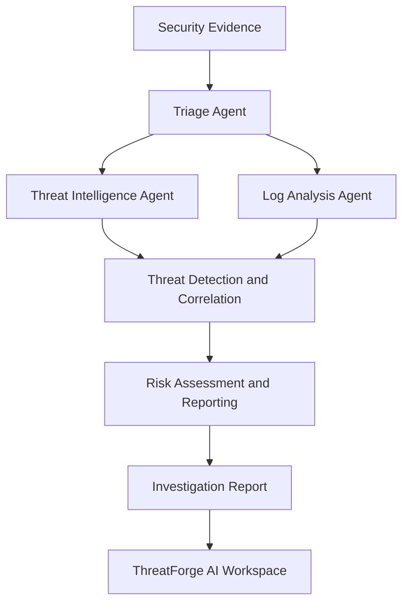

# ThreatForge AI
### Multi-Agent AI Cybersecurity Investigation Platform

**Turning Security Evidence into Structured Intelligence.**

ThreatForge AI is an AI-powered cybersecurity investigation platform designed to analyze suspicious security evidence, coordinate specialized AI agents, correlate potential threats, and generate structured investigation reports.

Built using **Python, FastAPI, LangGraph, Groq, Next.js, React, and TypeScript**, ThreatForge AI brings multiple investigation capabilities together in a centralized intelligence workspace.

The platform aims to make cybersecurity investigations more organized, explainable, and efficient by combining AI-powered analysis with evidence-based investigation workflows.

---

## Project Overview

Cybersecurity investigations often involve examining multiple sources of information, including suspicious IP addresses, URLs, file hashes, network activity, and security logs.

Manually analyzing these indicators and connecting related findings can be time-consuming.

ThreatForge AI addresses this challenge through a coordinated multi-agent architecture.

Users can submit security evidence, initiate an investigation, and review the results through an interactive investigation workspace.

The platform coordinates specialized agents to:

- Examine submitted security evidence.
- Analyze relevant threat intelligence.
- Investigate security logs.
- Identify potential relationships between findings.
- Assess investigation risk and confidence.
- Generate structured investigation reports.

ThreatForge AI focuses on presenting findings with supporting evidence rather than automatically treating every suspicious indicator as a confirmed threat.

---

## Key Features

### 1. AI-Powered Multi-Agent Investigation

A LangGraph-powered workflow coordinates specialized AI agents, each responsible for a different investigation task.

### 2. Security Evidence Analysis

Designed to analyze security-related evidence, including:

- IP addresses
- Suspicious URLs
- File hashes
- Security logs
- Network-related evidence
- Incident descriptions

### 3. Threat Intelligence Analysis

Supports threat intelligence enrichment through configured external services, including:

- VirusTotal
- AbuseIPDB

### 4. Threat Detection and Correlation

Combines findings from different investigation stages to identify relationships, suspicious patterns, and potential threat hypotheses.

### 5. Risk Assessment

Organizes investigation results into risk classifications and confidence assessments to help users understand the significance of the findings.

### 6. Investigation Command Center

A centralized workspace designed to display:

- Executive Summary
- Investigation Overview
- Agent Execution Status
- Selected Agent Findings
- Evidence Intelligence
- Threat Correlations
- Risk Assessment
- Log Intelligence
- Investigation Limitations

### 7. Investigation History

Provides access to recorded investigations and their associated results through the application interface.

### 8. Structured Investigation Reports

Generates organized investigation summaries containing findings, evidence, classifications, and recommendations.

### 9. Interactive Dashboard

A modern web interface built to make complex investigation information easier to explore and understand.

---

## AI Agent Architecture

ThreatForge AI uses five specialized agents coordinated through LangGraph.

| Agent | Responsibility |
|---|---|
| Triage Agent | Examines submitted evidence and identifies relevant indicators. |
| Threat Intelligence Agent | Retrieves available intelligence information about relevant indicators. |
| Log Analysis Agent | Examines security logs and identifies potentially suspicious activity. |
| Threat Detection & Correlation Agent | Correlates findings and identifies potential threat patterns. |
| Risk Assessment & Reporting Agent | Evaluates investigation findings and generates a structured report. |

### Investigation Workflow



Each agent contributes its findings to the shared investigation workflow. LangGraph manages the coordination and progression of the investigation stages.

---

## Technology Stack

ThreatForge AI combines modern web development technologies, AI frameworks, and cybersecurity intelligence services.

### Frontend Technologies

| Technology | Purpose |
|---|---|
| Next.js | Frontend application framework |
| React.js | Component-based user interface |
| TypeScript | Type-safe application development |
| Tailwind CSS | UI styling and responsive layouts |
| JavaScript | Frontend application logic |
| CSS | Custom interface styling |

### Backend Technologies

| Technology | Purpose |
|---|---|
| Python | Core backend programming |
| FastAPI | REST API development |
| Uvicorn | ASGI application server |
| Pydantic | Data validation and structured schemas |

### AI and Agent Technologies

| Technology | Purpose |
|---|---|
| LangGraph | Multi-agent workflow orchestration |
| Groq API | LLM inference |
| Large Language Models | Investigation analysis and report generation |

### Cybersecurity Technologies

| Technology | Purpose |
|---|---|
| VirusTotal API | Threat intelligence enrichment |
| AbuseIPDB API | IP reputation information |
| Security Log Analysis | Investigation of relevant security events |
| CIC-IDS Dataset | Network intrusion detection research data, where configured |

### Development and Deployment

| Technology | Purpose |
|---|---|
| Git | Version control |
| GitHub | Source code management |
| npm | Frontend dependency management |
| Python Virtual Environment | Backend dependency isolation |
| Vercel | Frontend deployment |

*Technology and integration availability depends on the actual project configuration and installed dependencies.*

---

## System Architecture

ThreatForge AI follows a frontend-backend architecture.

```text
                    USER
                     |
                     v
           NEXT.JS FRONTEND
           React + TypeScript
                     |
                     v
              FASTAPI BACKEND
                     |
                     v
             LANGGRAPH WORKFLOW
                     |
        +------------+------------+
        |            |            |
        v            v            v
      Triage     Threat Intel   Log Analysis
       Agent        Agent         Agent
        |            |            |
        +------------+------------+
                     |
                     v
             THREAT CORRELATION
                     |
                     v
             RISK ASSESSMENT
                     |
                     v
             INVESTIGATION REPORT
                     |
                     v
            INVESTIGATION WORKSPACE
```

---

## Project Structure

```text
ThreatForge-AI/
│
├── backend/
│   ├── main.py
│   ├── graph.py
│   ├── csv_loader.py
│   ├── data/
│   └── requirements.txt
│
├── frontend/
│   ├── components/
│   │   ├── AppLayout.tsx
│   │   ├── Sidebar.tsx
│   │   └── CasebookWorkspace.tsx
│   │
│   ├── pages/
│   │   ├── index.tsx
│   │   └── ...
│   │
│   ├── lib/
│   ├── public/
│   ├── package.json
│   └── ...
│
├── .gitignore
└── README.md
```

*This is a simplified representation of the main project structure.*

---

## Getting Started

Follow the steps below to run ThreatForge AI locally.

### Prerequisites

Install the following tools:

- Python 3.10 or a version compatible with the backend dependencies
- Node.js
- npm
- Git

### 1. Clone the Repository

```bash
git clone https://github.com/Rameeshafatima-png/ThreatForge-AI.git

cd ThreatForge-AI
```

### 2. Backend Setup

Navigate to the backend directory:

```bash
cd backend
```

Create a virtual environment:

```bash
python -m venv .venv
```

Activate the environment on Windows:

```powershell
.venv\Scripts\activate
```

Install backend dependencies:

```bash
pip install -r requirements.txt
```

### 3. Configure Environment Variables

Create a `.env` file in the backend directory and add the configuration required by your application.

Example:

```env
GROQ_API_KEY=your_groq_api_key
GROQ_MODEL=your_configured_model

VT_API_KEY=your_virustotal_api_key
ABUSEIPDB_API_KEY=your_abuseipdb_api_key
```

Only configure the integrations used by your backend.

Keep API keys private. Never upload `.env` files or secrets to GitHub.

### 4. Run the Backend

From the backend directory:

```bash
uvicorn main:app --reload --port 8000
```

Backend URL:

```text
http://localhost:8000
```

FastAPI documentation:

```text
http://localhost:8000/docs
```

### 5. Frontend Setup

Open another terminal and navigate to the frontend:

```bash
cd frontend
```

Install dependencies:

```bash
npm install
```

Create a `.env.local` file inside the frontend directory:

```env
NEXT_PUBLIC_API_URL=http://localhost:8000
```

Make sure this variable matches the API configuration used by the frontend.

### 6. Run the Frontend

```bash
npm run dev
```

Open the application:

```text
http://localhost:3000
```

**Important:** Keep both the backend and frontend servers running while using the local application.

---

## API Documentation

ThreatForge AI uses FastAPI to provide backend functionality.

Once the backend is running, access the interactive API documentation at:

```text
http://localhost:8000/docs
```

This documentation allows developers to explore the available API endpoints, request schemas, and responses.

---

## Deployment

ThreatForge AI consists of a frontend and a backend that must be deployed and connected separately.

### Frontend Deployment

The Next.js frontend can be deployed using Vercel.

Recommended configuration:

| Setting | Configuration |
|---|---|
| Framework | Next.js |
| Root Directory | frontend |
| Install Command | npm install |
| Build Command | npm run build |
| Output Directory | Default |

Add the frontend environment variable in Vercel:

```env
NEXT_PUBLIC_API_URL=https://your-backend-domain
```

Replace the example URL with the actual deployed backend URL.

### Backend Deployment

Deploy the FastAPI backend on a Python-compatible hosting platform.

Configure the required environment variables and make sure the production frontend origin is allowed through CORS.

After deployment, update the frontend API URL and redeploy the frontend if necessary.

---

## Security Considerations

ThreatForge AI is designed as an investigation-support platform.

Important security principles include:

- Protect private API credentials.
- Validate submitted security evidence.
- Restrict CORS to trusted origins.
- Treat external intelligence information as supporting evidence.
- Distinguish observed facts from generated hypotheses.
- Communicate uncertainty and investigation limitations.
- Use human review before consequential security response actions.

AI-generated assessments should not be treated as a substitute for professional security analysis.

---

## Future Enhancements

Potential improvements for future development include:

- Advanced threat correlation capabilities.
- Additional threat intelligence integrations.
- More security log parsers.
- Improved investigation persistence.
- Investigation report exports.
- Advanced evidence visualization.
- Background agent execution.
- More comprehensive testing and evaluation.
- Enhanced human-review workflows.

---

## Project Vision

ThreatForge AI explores the potential of multi-agent artificial intelligence in modern cybersecurity investigations.

By bringing evidence analysis, threat intelligence, log investigation, threat correlation, and risk assessment into one platform, ThreatForge aims to simplify complex security investigation workflows.

**From suspicious indicators to structured intelligence.**

---

## Author

**Rameesha Fatima**

GitHub: [@Rameeshafatima-png](https://github.com/Rameeshafatima-png)

Project Repository: [ThreatForge AI](https://github.com/Rameeshafatima-png/ThreatForge-AI)

---

## License

This project is developed for educational, research, and experimentation purposes.

A specific open-source license can be added to the repository when distribution terms are decided.